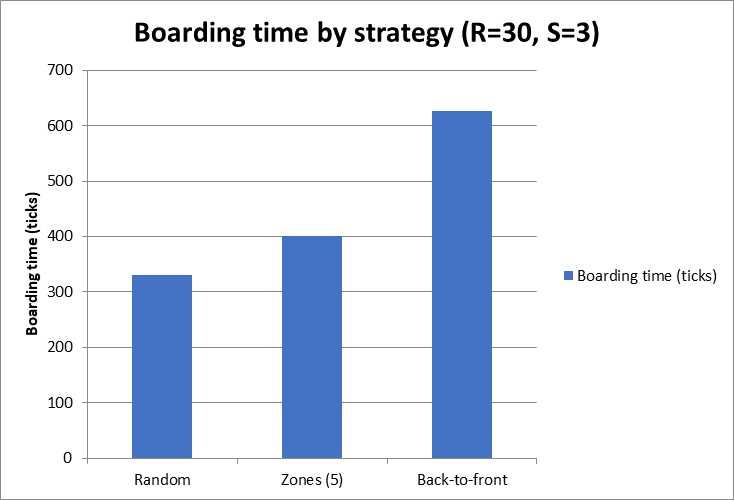
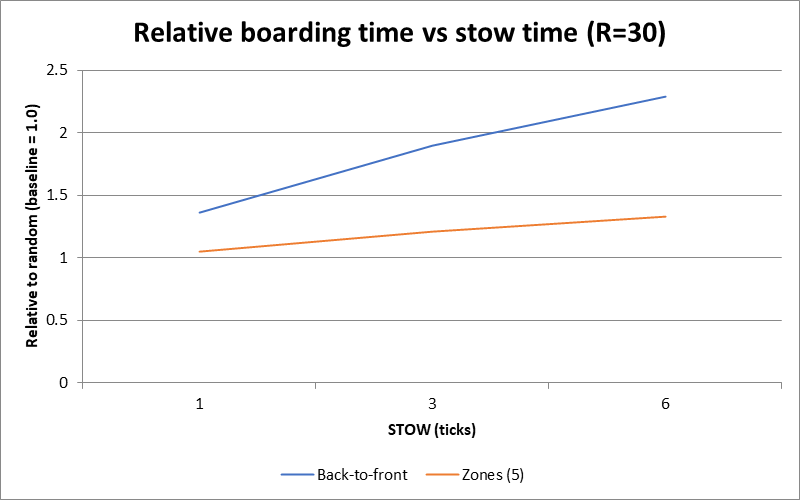
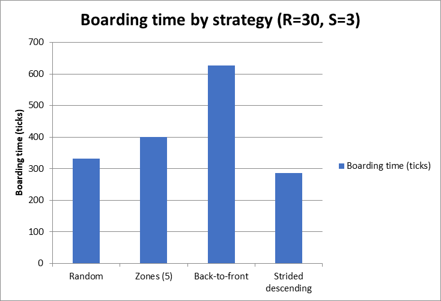
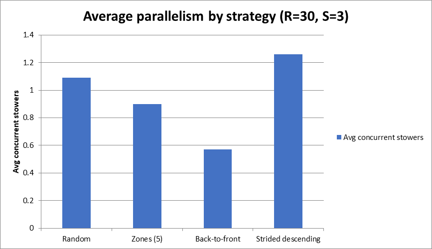
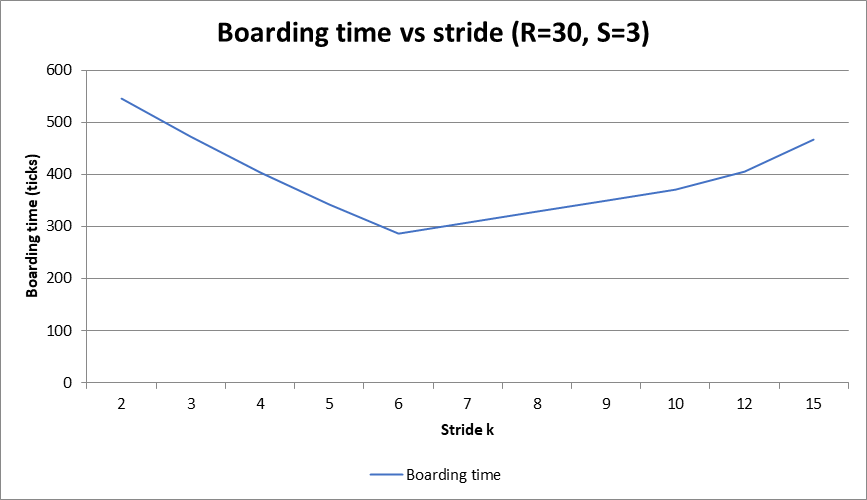

```{=latex}
\begin{center}
{\LARGE\bfseries The Effect of Boarding Strategies on Aircraft Boarding Efficiency}\\[6pt]
{\large A Simulation-Based Study with an Exact Longest-Path (Max-Plus) Theory}\\[8pt]
Zihao Huang (independent researcher) \quad October 2026
\end{center}
\vspace{6pt}
```

# Abstract

This study compares aircraft boarding strategies — random, back-to-front, zoning (5 zones), and a new *strided-descending* order — using a single-aisle simulation. Contrary to intuition, **back-to-front is the slowest, random already beats it**, and a strided-descending order is **faster still**; the gaps widen with stow time and cabin size. We derive an **exact theoretical model** that computes the boarding time directly (without tick-by-tick simulation) as the length of a longest path in a max-plus recurrence; it reproduces the simulation **bit-for-bit** (verified over more than 25,000 cases) and yields provable lower bounds. Finally, two measured mechanism metrics — parallelism (passengers stowing simultaneously) and blocking events — explain why the faster orders win.

# 1 Background and Research Question

Boarding time affects on-time performance and operating cost. Airlines often use "zone boarding" or "back-to-front boarding", but whether these beat random boarding is debated. We test:

**Hypothesis H:** Organized strategies (back-to-front / zoning) board faster than random boarding does.

# 2 Methods

## 2.1 Simulation model

- Single-aisle cabin; passengers enter from the front and walk to their row.
- On reaching the row, a passenger stows luggage, occupying the aisle for $S$ ticks; followers cannot pass.
- One cell of forward motion per tick; no overtaking; one passenger enters per tick.
- Total ticks until all are seated = boarding time (smaller = faster).

## 2.2 Variables

| Type | Variable |
|---|---|
| Independent | Boarding strategy (Random / Back-to-front / Zones-5 / Strided descending) |
| Dependent | Total boarding time $T$ (ticks) |
| Control (baseline) | Random boarding (normalized to 1.00) |
| Controlled | Rows $R$; seats per row (6); entry rate (1/tick); repeats (100) |

## 2.3 Theoretical model: an exact longest-path (max-plus) formulation

We model boarding as a discrete-time single-lane exclusion process and derive an exact recurrence for $T$. The cabin has cells $1..R$; passengers enter in the order $i=1..N$, so let

- $r_i$ — the target row of passenger $i$, and $S$ the stow time;
- $P_i(c)$ — the tick at which passenger $i$ reaches cell $c$;
- $j=j_i(c)$ — the last passenger before $i$ that reaches cell $c$.

Passenger $i$ reaches cell $c$ at the later of two times: its own pace, and the moment cell $c$ becomes free:

$$P_i(c)=\max\{P_i(c-1)+1,\;B_i(c)\},\qquad
B_i(c)=\begin{cases}P_j(c)+1+S, & r_j=c\quad(j\text{ stows at row }c),\\[2pt] P_j(c+1), & r_j>c\quad(j\text{ passes through}).\end{cases}$$

With the exact entrance conventions (entering is its own tick; right after entering one may move one extra cell):

$$P_i(1)=\max\{i,B_i(1)\},\qquad P_i(2)=\max\{P_i(1),B_i(2)\},\qquad P_i(c)=\max\{P_i(c-1)+1,B_i(c)\}\ \text{ for }c\ge 3.$$

At the entrance cell, when the passenger ahead only passes through ($r_j>1$), entering is its own step, so

$$B_i(1)=P_j(2)+1.$$

The finish time of passenger $i$ and the total time are

$$F_i=P_i(r_i)+[\,r_i\ge 2\,]+S-1,\qquad T=\max_i F_i.$$

**Interpretation.** Every $P_i(c)$ is a max of two terms ("my own pace" vs "waiting for the person ahead"), so $T$ is the length of the longest chain of waits — a longest path (last-passage percolation) value on the space–time lattice.

### 2.3.1 Worked example

Take $R=3$ rows, one seat per row, $S=1$, and boarding order $r=[3,1,2]$ (passenger 1 goes to row 3, passenger 2 to row 1, passenger 3 to row 2). Applying the recurrence cell by cell (write $P_1,P_2,P_3$ for $P_i(1),P_i(2),P_i(3)$):

| Passenger $i$ | $r_i$ | Cell-by-cell computation | Finish $F_i$ |
|---|---|---|---|
| 1 | 3 | $P_1=\max(1,0)=1$; $P_2=\max(1,0)=1$; $P_3=\max(1+1,0)=2$ | $2+1+1-1=3$ |
| 2 | 1 | $B_1=P^{(1)}_2+1=2$; $P_1=\max(2,2)=2$ | $2+0+1-1=2$ |
| 3 | 2 | $B_1=P^{(2)}_1+S=3\Rightarrow P_1=3$; $B_2=P^{(1)}_3=2\Rightarrow P_2=\max(3,2)=3$ | $3+1+1-1=4$ |

Thus $T=\max(3,2,4)=4$, which matches the simulation exactly.

### 2.3.2 Verification

Implementing the recurrence above reproduces the simulation bit-for-bit. The table uses deterministic strategies — their boarding orders are fully specified, so both the simulation and the recurrence are exactly reproducible:

| Case (deterministic order) | $T$ (simulation) | $T$ (theory) | Match |
|---|---|---|---|
| Back-to-front, $R=30$, $S=3$ | 627 | 627 | true |
| Back-to-front, $R=30$, $S=6$ | 1080 | 1080 | true |
| Strided descending, $R=30$, $S=3$ | 286 | 286 | true |
| Strided descending, $R=30$, $S=6$ | 394 | 394 | true |

Random and zoning generate a different order each run, unlike the deterministic cases above. To cover them, we ran a full comparison over **25,600 test cases** — varying $R=1..8$, $S=1..5$, the number of seats per row, and four boarding patterns — and found **0 mismatches**. The recurrence is therefore an exact theory of the process, not an approximation.

## 2.4 Lower bounds

**Proposition 1 (entrance bound).** $T\ge N$. *Proof:* at most one passenger enters per tick, and all $N$ must enter.

**Proposition 2 (occupancy bound).** $T\ge\left(\sum_i r_i+N S\right)/R$. *Proof:* passenger $i$ occupies $r_i$ cell-ticks while walking and $S$ while stowing, so total occupancy is $\sum_i r_i+N S$; at most $R$ cells can be occupied in any tick. For 6 seats per row ($\sum_i r_i=3R(R+1)$): $T\ge 3(R+1)+6S$.

## 2.5 Data collection

Strategies with randomness (Random, Zones) are run **100 times and averaged**; Back-to-front and strided descending are deterministic (single run). Results are reported relative to random (baseline = 1.00).

# 3 Results

## 3.1 Main result ($R=30$ rows, 6 seats per row, $N=180$ passengers, $S=3$)

| Strategy | Average boarding time (ticks) | Relative to random |
|---|---|---|
| Random | 331.1 | 1.00 (baseline) |
| Zones (5) | 400.8 | 1.21 |
| Back-to-front | 627.0 | 1.89 |

{width=88%}

Figure 1. Boarding time by strategy (R=30, S=3): random fastest, back-to-front slowest.

## 3.2 Sensitivity analysis

**(a) Stow time (fixed $R=30$).**

| $S$ | Random | Back-to-front | Zones (5) | Rel. random (back) | Rel. random (zones) |
|---|---|---|---|---|---|
| 1 | 239.1 | 325 | 250.0 | 1.36 | 1.05 |
| 3 | 331.1 | 627 | 400.8 | 1.89 | 1.21 |
| 6 | 472.2 | 1080 | 628.7 | 2.29 | 1.33 |

{width=88%}

Figure 2. Relative boarding time vs stow time (R=30).

**(b) Number of rows (fixed $S=3$).**

| Rows $R$ | Random | Back-to-front | Zones (5) | Rel. random (back) | Rel. random (zones) |
|---|---|---|---|---|---|
| 20 | 237.2 | 417 | 290.8 | 1.76 | 1.23 |
| 30 | 331.1 | 627 | 400.8 | 1.89 | 1.21 |
| 40 | 422.7 | 837 | 503.2 | 1.98 | 1.19 |

## 3.3 A faster strategy: strided descending boarding

We also tested strided orders: rows are split into groups by residue mod 6 — group 1 = {1, 7, 13, 19, 25}, group 2 = {2, 8, 14, 20, 26}, and so on — and each group is boarded either ascending or descending. The **direction turns out to matter critically**: boarding each group in descending order (…, 19, 13, 7, 1) is far faster than ascending order, and it even beats random boarding:

| Strategy | $S=1$ | $S=3$ | $S=6$ |
|---|---|---|---|
| Random | 239.1 | 331.1 | 472.2 |
| Zones (5) | 250.0 | 400.8 | 628.7 |
| Back-to-front | 325 | 627 | 1080 |
| Strided ascending (stride 6) | 322 | 562 | 922 |
| Strided descending (stride 6) | 214 | 286 | 394 |

{width=88%}

Figure 3. Boarding time by strategy, including the strided-descending order (R=30, S=3).

Strided descending boarding is the fastest — e.g. **286 vs 331** (≈14% faster) at $S=3$ — and the advantage grows with $S$ (≈17% at $S=6$). The theory reproduces these values exactly (286/286).

## 3.4 Why it is faster: parallelism and blocking

To explain the differences above, the simulator records, at each tick $t$, two quantities: $K(t)$ = the number of passengers **stowing simultaneously** (parallelism), and $B(t)$ = the number of walkers **blocked** because the cell ahead is occupied. Over a boarding of total length $T$ ticks, we report the average parallelism $(1/T)\sum_{t=1}^{T}K(t)$ and the total number of blocking events $\sum_{t=1}^{T}B(t)$.

| Strategy | Time (ticks) | Avg parallelism | Total blocking |
|---|---|---|---|
| Strided descending | 286.0 | 1.26 | 1,305 |
| Random | 331.1 | 1.09 | 958 |
| Zones (5) | 400.8 | 0.90 | 2,989 |
| Back-to-front | 627.0 | 0.57 | 6,525 |

{width=88%}

Figure 4. Average parallelism by strategy (R=30, S=3).

Across all four strategies, higher parallelism goes with shorter boarding time (Figure 4), and back-to-front combines the lowest parallelism with the most blocking events. The theory of Section 2.3 explains this: in descending order each subsequent passenger stops *before* the previous stower's row, so nobody has to squeeze past an occupied cell, whereas ascending order does the opposite and creates cascading blocking.

## 3.5 Effect of the stride

Direction is not the only design choice in strided boarding; the order also depends on the stride $k$ (rows are grouped by residue mod $k$; all earlier results use $k=6$). The stride acts through the same mechanism as in Section 3.4: a larger $k$ leaves fewer rows per group and spreads stowing out (higher parallelism), whereas a smaller $k$ packs rows densely and invites cascading blocking. To see whether $k$ matters, we varied it for $R=30$, $S=3$:

| Stride $k$ | Boarding time (ticks) |
|---|---|---|
| 2 | 546 |
| 3 | 472 |
| 4 | 404 |
| 5 | 342 |
| 6 | 286 |
| 7 | 308 |
| 8 | 328 |
| 9 | 349 |
| 10 | 370 |
| 12 | 406 |
| 15 | 466 |

{width=88%}

Figure 5. Boarding time vs stride (R=30, S=3).

Boarding time is U-shaped in the stride — lowest at $k=6$ and rising for both smaller and larger $k$. A small stride packs closely spaced rows into large groups (more interference within a group); a large stride leaves too few rows per group (less parallelism). $k=6$ splits the cabin into blocks of $R/k=5$ rows, balancing the two. This small, self-contained optimum also foreshadows the open question in Section 5.

# 4 Discussion

The strided-descending order is fastest, random already beats back-to-front, and back-to-front is slowest. Random wins over back-to-front because it spreads passengers across rows so several rows stow simultaneously (highest parallelism, fewest blocking events); back-to-front boards each row's six passengers consecutively so they must stow one cell at a time (lowest parallelism, most blocking). The sensitivity analysis (Figure 2) confirms that the gap grows with stow time $S$, exactly as the recurrence's $+S$ blocking term predicts.

# 5 Is there an optimal boarding order? (open question)

The strided descending result shows that random is not necessarily optimal. Two facts frame the search for an optimum:

- **Lower bounds.** $T\ge\max\{N,\,3(R+1)+6S\}$. At $R=30$, $S=3$ this lower bound is **180**, while the best strategy found yields 286 — so room remains.
- **Mechanism.** Performance is governed by the longest chain of waits (the critical path). A good order keeps stowing spread over many rows and avoids forcing later passengers to pass an occupied cell.

We therefore **conjecture** that a near-optimal order is "descending in spirit": board so that passengers peel off toward the front without ever passing a stower, while spreading stowing across as many rows as possible. The true optimum likely lies between our strided order and the lower bound. Finding (or proving) the globally optimal order is an **open problem**; since the longest-path model evaluates any order efficiently ($O(N\cdot R)$ with preprocessing), it can be used to search the space of orderings, and an analytical argument may yield the optimum directly. We leave this to future work.

# 6 Limitations and Future Work

- Simplified model: no assigned-seat interference, no dual aisle or second door.
- The theoretical recurrence uses a naive $O(N)$ search for $j$; it can be reduced to $O(N\cdot R)$ overall with preprocessing.
- Future work: add the "Steffen method" and window–middle–aisle boarding; test a model in which parallelism is disabled as a direct causal test.

# 7 Conclusion

In this simulation the strided-descending order is fastest, random beats back-to-front, and back-to-front is slowest. The differences are explained by a measured mechanism (parallelism and blocking) and by an exact longest-path (max-plus) model that reproduces the simulation bit-for-bit. Boarding so that passengers stop before the previous stower keeps the critical path short — the underlying principle behind the observed gaps.

# Data and Code Availability

The simulation, the longest-path (max-plus) model, the interactive visualizer, and this report are openly available at [https://github.com/Huang-1226/boarding-order-simulation](https://github.com/Huang-1226/boarding-order-simulation) and archived with a DOI: [https://doi.org/10.5281/zenodo.23186759](https://doi.org/10.5281/zenodo.23186759). The text preparation and code implementation were assisted by the AI assistant opencode (see the Report on Use of AI Tools at the end of this document).

# References

1. Baccelli, F., Cohen, G., Olsder, G. J., & Quadrat, J.-P. (1992). *Synchronization and Linearity: An Algebra for Discrete Event Systems*. Wiley.
2. Bachmat, E., Berend, D., Sapir, L., Skiena, S., & Stolyarov, N. (2009). Analysis of airplane boarding times. *Operations Research*, 57(2), 499–513.
3. Steffen, J. H. (2008). Optimal boarding method for airline passengers. *Journal of Air Transport Management*, 14(3), 146–150.
4. Van Landeghem, H., & Beuselinck, A. (2002). Reducing passenger boarding time in airplanes: a simulation-based approach. *European Journal of Operational Research*, 142(2), 294–308.
5. opencode (AI coding assistant), deepseek-v4.1-flash model, October 2026. Used for code implementation and report text preparation; see Report on Use of AI Tools.

# Report on Use of AI Tools

The author used AI tools as follows. All scientific content — the simulation, the longest-path (max-plus) model, the data analysis, and the conclusions — is the author's own; every AI-generated or AI-rewritten item was reviewed and corrected by the author, who takes full responsibility.

1. **opencode** (AI coding assistant), deepseek-v4.1-flash model (October 2026 version). Under the author's direction, it implemented the models in Python and JavaScript, built the interactive simulation website and UI, and assisted with the report's language polishing, structural editing, and Chinese–English translation.
2. The author was responsible for the research topic, the study design, and the model design.

**Statement:** All AI output was checked and corrected item by item; this disclosure is for transparency and does not imply that AI contributed to the scientific conclusions.
