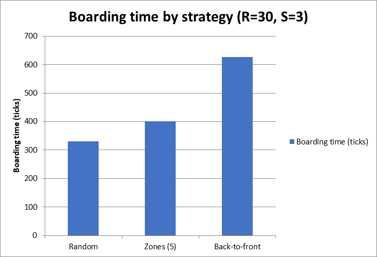
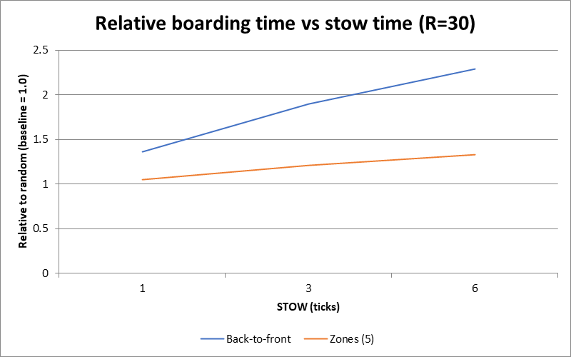
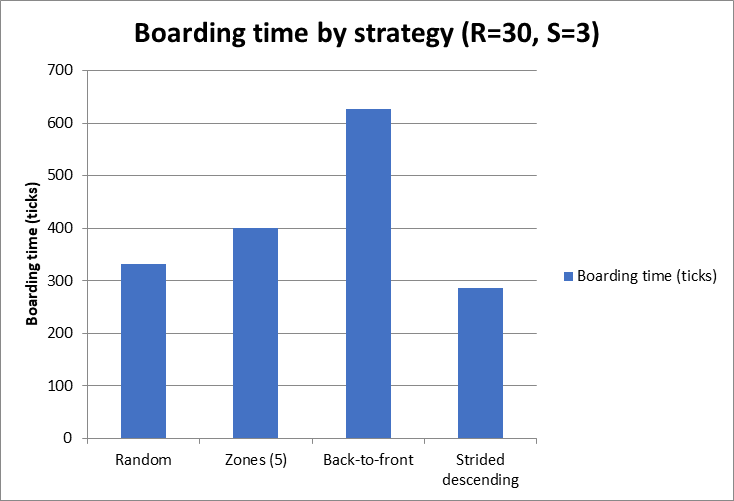
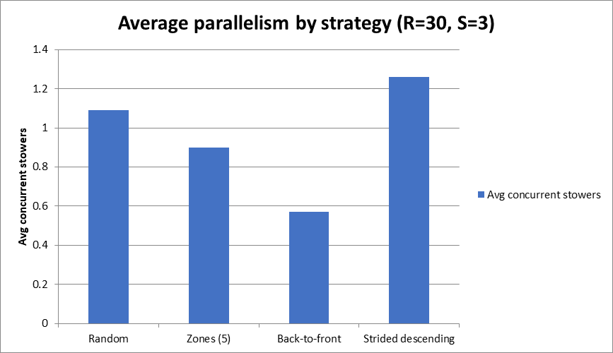
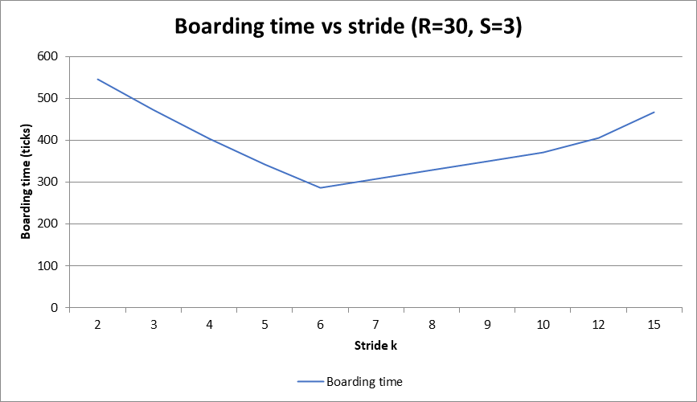

```{=latex}
\begin{center}
{\LARGE\bfseries 登机顺序对飞机登机效率的影响}\\[4pt]
{\large ——基于仿真的研究与精确最长路（max-plus）理论}\\[8pt]
黄子豪（独立研究者）\quad 2026 年 10 月
\end{center}
\vspace{6pt}
```

# 摘要

本文用单通道登机仿真比较了四种登机策略——随机、从后往前、分区（5 区），以及一种新的**交错倒序**策略。与直觉相反：**从后往前最慢，随机已经比它快**，而交错倒序还**更快**；放行李时间越长、机舱越大，差距越大。我们推导了一个**精确理论模型**，无需逐步仿真即可直接计算登机时间：它等于 max-plus 递推中一条**最长路**的长度。该模型与仿真**逐位一致**（在超过 25,000 个算例上验证），并给出可证明的下界。最后，我们用两个可测量的机制指标——并行度（同时放行李的乘客数）与堵塞次数——解释了为什么更快的顺序更快。

# 1 背景与研究问题

登机时间影响航班正点率与运营成本。航空公司常采用“分区登机”或“从后往前登机”，但它们是否优于随机登机仍有争议。我们检验：

**假设 H：** 有组织的策略（从后往前 / 分区）比随机登机更快。

# 2 方法

## 2.1 仿真模型

- 单通道机舱；乘客从前部进入并走向自己的座位排。
- 到达座位排后，乘客放行李，占用通道 $S$ 个 tick；后面的乘客无法超越。
- 每个 tick 前进一格；禁止超车；每个 tick 只允许一名乘客进入。
- 所有乘客就座所需的总 tick 数即登机时间（越小越快）。

## 2.2 变量

| 类型 | 变量 |
|---|---|
| 自变量 | 登机策略（随机 / 从后往前 / 5 区 / 交错倒序） |
| 因变量 | 总登机时间 $T$（tick） |
| 对照（基线） | 随机登机（归一化为 1.00） |
| 控制变量 | 排数 $R$；每排座位数（6）；进入速率（1/tick）；重复次数（100） |

## 2.3 理论模型：精确的最长路（max-plus）表述

我们把登机建模为离散时间的单通道排他过程，并推导 $T$ 的精确递推。机舱有 $1..R$ 个格点；乘客按 $i=1..N$ 的顺序进入，定义：

- $r_i$ —— 乘客 $i$ 的目标排， $S$ 为放行李时间；
- $P_i(c)$ —— 乘客 $i$ 到达格点 $c$ 的 tick；
- $j=j_i(c)$ —— 乘客 $i$ 之前最后一个到达格点 $c$ 的乘客。

乘客 $i$ 到达格点 $c$ 的时刻，取“自身步速”与“格点 $c$ 空出”两者中的较晚者：

$$P_i(c)=\max\{P_i(c-1)+1,\;B_i(c)\},\qquad
B_i(c)=\begin{cases}P_j(c)+1+S, & r_j=c\quad(j\text{ 在 }c\text{ 排放行李}),\\[2pt] P_j(c+1), & r_j>c\quad(j\text{ 仅经过}).\end{cases}$$

入口约定为精确形式（进入本身占一个 tick；刚进入后可再前进一格）：

$$P_i(1)=\max\{i,B_i(1)\},\qquad P_i(2)=\max\{P_i(1),B_i(2)\},\qquad P_i(c)=\max\{P_i(c-1)+1,B_i(c)\}\ \text{（}c\ge 3\text{）}.$$

在入口格点，若前一名乘客只是经过（$r_j>1$），进入本身是一步，因此

$$B_i(1)=P_j(2)+1.$$

乘客 $i$ 的完成时间与总时间为

$$F_i=P_i(r_i)+[\,r_i\ge 2\,]+S-1,\qquad T=\max_i F_i.$$

**解释。** 每个 $P_i(c)$ 都是两项的最大值（“自己的步速”与“等前面的人”），因此 $T$ 是最长等待链的长度——即时空格点上的最长路（最后通过渗流）值。

### 2.3.1 算例

取 $R=3$ 排、每排 1 个座位、$S=1$，登机顺序 $r=[3,1,2]$（乘客 1 去第 3 排，乘客 2 去第 1 排，乘客 3 去第 2 排）。逐格应用递推（记 $P_1,P_2,P_3$ 为 $P_i(1),P_i(2),P_i(3)$）：

| 乘客 $i$ | $r_i$ | 逐格计算 | 完成 $F_i$ |
|---|---|---|---|
| 1 | 3 | $P_1=\max(1,0)=1$；$P_2=\max(1,0)=1$；$P_3=\max(1+1,0)=2$ | $2+1+1-1=3$ |
| 2 | 1 | $B_1=P^{(1)}_2+1=2$；$P_1=\max(2,2)=2$ | $2+0+1-1=2$ |
| 3 | 2 | $B_1=P^{(2)}_1+S=3\Rightarrow P_1=3$；$B_2=P^{(1)}_3=2\Rightarrow P_2=\max(3,2)=3$ | $3+1+1-1=4$ |

于是 $T=\max(3,2,4)=4$，与仿真完全一致。

### 2.3.2 验证

上述递推的实现与仿真逐位一致。下表使用确定性策略——其登机顺序完全给定，因此仿真与递推都可精确复现：

| 情形（确定性顺序） | $T$（仿真） | $T$（理论） | 是否一致 |
|---|---|---|---|
| 从后往前，$R=30$，$S=3$ | 627 | 627 | 是 |
| 从后往前，$R=30$，$S=6$ | 1080 | 1080 | 是 |
| 交错倒序，$R=30$，$S=3$ | 286 | 286 | 是 |
| 交错倒序，$R=30$，$S=6$ | 394 | 394 | 是 |

随机与分区每次运行会生成不同顺序，不同于上表的确定性情形。为覆盖它们，我们在 **25,600 个算例** 上做了完整比较——遍历 $R=1..8$、$S=1..5$、每排座位数与四种登机模式——结果 **0 处不一致**。因此该递推是这一过程的精确理论，而非近似。

## 2.4 下界

**命题 1（入口下界）。** $T\ge N$。*证明：* 每个 tick 最多进入一人，且 $N$ 人必须全部进入。

**命题 2（占用下界）。** $T\ge\left(\sum_i r_i+N S\right)/R$。*证明：* 乘客 $i$ 行走时占用 $r_i$ 个“格点·tick”，放行李时占用 $S$ 个；总占用为 $\sum_i r_i+N S$，而任一 tick 最多占用 $R$ 个格点。对每排 6 座（$\sum_i r_i=3R(R+1)$）：$T\ge 3(R+1)+6S$。

## 2.5 数据采集

带随机性的策略（随机、分区）各运行 **100 次取平均**；从后往前与交错倒序是确定性的（单次运行）。结果均相对于随机（基线 = 1.00）报告。

# 3 结果

## 3.1 主要结果（$R=30$ 排，每排 6 座，$N=180$ 名乘客，$S=3$）

| 策略 | 平均登机时间（tick） | 相对随机 |
|---|---|---|
| 随机 | 331.1 | 1.00（基线） |
| 分区（5 区） | 400.8 | 1.21 |
| 从后往前 | 627.0 | 1.89 |

{width=88%}

图 1. 各策略的登机时间（R=30，S=3）：随机最快，从后往前最慢。

## 3.2 敏感性分析

**（a）放行李时间（固定 $R=30$）。**

| $S$ | 随机 | 从后往前 | 分区（5 区） | 相对随机（从后往前） | 相对随机（分区） |
|---|---|---|---|---|---|
| 1 | 239.1 | 325 | 250.0 | 1.36 | 1.05 |
| 3 | 331.1 | 627 | 400.8 | 1.89 | 1.21 |
| 6 | 472.2 | 1080 | 628.7 | 2.29 | 1.33 |

{width=88%}

图 2. 相对登机时间随放行李时间的变化（R=30）。

**（b）排数（固定 $S=3$）。**

| 排数 $R$ | 随机 | 从后往前 | 分区（5 区） | 相对随机（从后往前） | 相对随机（分区） |
|---|---|---|---|---|---|
| 20 | 237.2 | 417 | 290.8 | 1.76 | 1.23 |
| 30 | 331.1 | 627 | 400.8 | 1.89 | 1.21 |
| 40 | 422.7 | 837 | 503.2 | 1.98 | 1.19 |

## 3.3 更快的策略：交错倒序登机

我们还测试了“交错”顺序：按模 6 的余数把排分成若干组——第 1 组 = {1, 7, 13, 19, 25}，第 2 组 = {2, 8, 14, 20, 26}，依此类推——每组再按升序或降序登机。**方向的影响是决定性的**：每组按降序（…, 19, 13, 7, 1）登机远快于升序，甚至快于随机：

| 策略 | $S=1$ | $S=3$ | $S=6$ |
|---|---|---|---|
| 随机 | 239.1 | 331.1 | 472.2 |
| 分区（5 区） | 250.0 | 400.8 | 628.7 |
| 从后往前 | 325 | 627 | 1080 |
| 交错升序（步长 6） | 322 | 562 | 922 |
| 交错倒序（步长 6） | 214 | 286 | 394 |

{width=88%}

图 3. 各策略的登机时间，含交错倒序（R=30，S=3）。

交错倒序最快——例如 $S=3$ 时 **286 对 331**（约快 14%）——且优势随 $S$ 增大（$S=6$ 时约 17%）。理论精确复现了这些数值（286/286）。

## 3.4 为什么更快：并行度与堵塞

为解释上述差异，仿真器在每个 tick $t$ 记录两个量：$K(t)$ = **同时放行李**的乘客数（并行度），$B(t)$ = 因前方格点被占而**被堵**的行走者数。对总时长为 $T$ 个 tick 的一次登机，我们报告平均并行度 $(1/T)\sum_{t=1}^{T}K(t)$ 与堵塞事件总数 $\sum_{t=1}^{T}B(t)$。

| 策略 | 时间（tick） | 平均并行度 | 总堵塞次数 |
|---|---|---|---|
| 交错倒序 | 286.0 | 1.26 | 1,305 |
| 随机 | 331.1 | 1.09 | 958 |
| 分区（5 区） | 400.8 | 0.90 | 2,989 |
| 从后往前 | 627.0 | 0.57 | 6,525 |

{width=88%}

图 4. 各策略的平均并行度（R=30，S=3）。

在四种策略中，并行度越高登机时间越短（图 4），而从后往前同时具有最低的并行度和最多的堵塞。2.3 节的理论解释了这一点：降序时后续乘客都在前一名放行李者的**排之前**停下，因此无人需要挤过被占用的格点；升序则相反，造成连锁堵塞。

## 3.5 步长的影响

方向不是交错登机的唯一设计变量；顺序还取决于步长 $k$（按模 $k$ 的余数分组；前面所有结果取 $k=6$）。步长通过 3.4 节相同的机制起作用：$k$ 越大，每组排数越少、放行李越分散（并行度越高）；$k$ 越小，排越密集、越容易连锁堵塞。为考察 $k$ 的影响，我们在 $R=30$、$S=3$ 下改变 $k$：

| 步长 $k$ | 登机时间（tick） |
|---|---|
| 2 | 546 |
| 3 | 472 |
| 4 | 404 |
| 5 | 342 |
| 6 | 286 |
| 7 | 308 |
| 8 | 328 |
| 9 | 349 |
| 10 | 370 |
| 12 | 406 |
| 15 | 466 |

{width=88%}

图 5. 登机时间随步长的变化（R=30，S=3）。

登机时间关于步长呈 **U 形**——在 $k=6$ 处最低，向两侧都上升。步长太小会把相邻排挤进大组（组内干扰更多）；步长太大则每组排数太少（并行度不足）。$k=6$ 把机舱分成 $R/k=5$ 排一块，平衡了二者。这个小而自洽的最优值也预示了第 5 节的开放问题。

# 4 讨论

交错倒序最快，随机已经快于从后往前，从后往前最慢。随机胜过从后往前，是因为它把乘客分散到各排，使多排同时放行李（并行度最高、堵塞最少）；从后往前把每排 6 人连续安排，只能一格一格地放行李（并行度最低、堵塞最多）。敏感性分析（图 2）确认差距随放行李时间 $S$ 增大，这正是递推中 $+S$ 堵塞项所预测的。

# 5 是否存在最优登机顺序？（开放问题）

交错倒序的结果说明随机未必最优。两个事实界定了对最优解的搜索：

- **下界。** $T\ge\max\{N,\,3(R+1)+6S\}$。在 $R=30$、$S=3$ 时下界为 **180**，而目前最好的策略为 286——仍有空间。
- **机制。** 性能由最长等待链（关键路径）决定。好的顺序应让放行李分散到多排，并避免迫使后来的乘客挤过被占用的格点。

因此我们**猜想**：近最优顺序应在“精神上是降序的”——让乘客向机头方向逐个下车，同时始终不越过正在放行李的人，并让放行李尽可能分散到多排。真正的最优解很可能位于我们的交错顺序与下界之间。找到（或证明）全局最优顺序是一个**开放问题**；由于最长路模型能高效评估任意顺序（预处理后 $O(N\cdot R)$），可用它搜索顺序空间，也可能通过解析论证直接得到最优解。我们将其留作未来工作。

# 6 局限与未来工作

- 简化模型：未考虑对号入座的相互干扰，未考虑双通道或第二舱门。
- 理论递推对 $j$ 采用朴素的 $O(N)$ 搜索；经预处理可降为整体 $O(N\cdot R)$。
- 未来工作：加入“Steffen 方法”与“窗口—中间—通道”登机；并测试一种“禁用并行度”的模型，作为直接的因果检验。

# 7 结论

在本仿真中，交错倒序最快，随机快于从后往前，从后往前最慢。这些差异可由一个可测量的机制（并行度与堵塞）以及一个与仿真逐位一致的精确最长路（max-plus）模型解释。让乘客在前一名放行李者之前停下，从而保持关键路径最短——这是上述差距背后的统一原理。

# 数据与代码可用性

仿真、最长路（max-plus）模型、交互式可视化以及本报告均公开于 [https://github.com/Huang-1226/boarding-order-simulation](https://github.com/Huang-1226/boarding-order-simulation)，并以 DOI 归档：[https://doi.org/10.5281/zenodo.23186759](https://doi.org/10.5281/zenodo.23186759)。文本准备与代码实现由 AI 助手 opencode 协助完成（见文末“AI 工具使用说明”）。

# 参考文献

1. Baccelli, F., Cohen, G., Olsder, G. J., & Quadrat, J.-P. (1992). *Synchronization and Linearity: An Algebra for Discrete Event Systems*. Wiley.
2. Bachmat, E., Berend, D., Sapir, L., Skiena, S., & Stolyarov, N. (2009). Analysis of airplane boarding times. *Operations Research*, 57(2), 499–513.
3. Steffen, J. H. (2008). Optimal boarding method for airline passengers. *Journal of Air Transport Management*, 14(3), 146–150.
4. Van Landeghem, H., & Beuselinck, A. (2002). Reducing passenger boarding time in airplanes: a simulation-based approach. *European Journal of Operational Research*, 142(2), 294–308.
5. opencode（AI 编程助手），deepseek-v4.1-flash 模型，2026 年 10 月。用于代码实现与报告文本准备；见“AI 工具使用说明”。

# AI 工具使用说明

作者对 AI 工具的使用如下。所有科学内容——仿真、最长路（max-plus）模型、数据分析与结论——均为作者本人完成；所有 AI 生成或改写的内容均经作者逐项检查与修正，作者承担全部责任。

1. **opencode**（AI 编程助手），deepseek-v4.1-flash 模型（2026 年 10 月版）。在作者指导下，它实现了 Python 与 JavaScript 模型，构建了交互式仿真网站与界面，并协助报告的语言润色、结构调整与中英翻译。
2. 研究选题、研究设计与模型设计由作者负责。

**声明：** 所有 AI 输出均已逐项检查与修正；本说明仅为透明起见，不代表 AI 参与了科学结论的形成。
